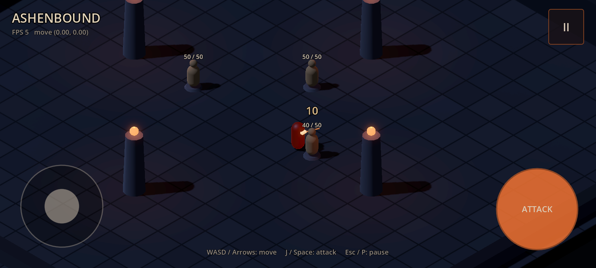

# Ashenbound

[](https://github.com/Bessv2/Ashenbound/actions/workflows/ci.yml)

A stylized 2.5D isometric dark fantasy action RPG for Android phones (landscape),
built with Godot 4 and GDScript.

**Status:** early prototype. A test arena with a placeholder player, a fixed
isometric camera, keyboard and touch-joystick movement, a HUD, pause/resume and
a settings structure, plus a first combat slice: a melee attack with aim assist
against training dummies that take damage, die and respawn. Loot, inventory,
real enemies, accounts and the backend have not been started.



## Repository layout

```
game/             Godot project (open this folder in the editor)
  scenes/         Gameplay scenes: main entry scene, arena, player, camera rig
  scripts/        Gameplay scripts: input, player, camera, combat, enemies, core
  ui/             HUD, touch joystick and buttons, pause menu, UI theme
  resources/      Materials, environment, movement and attack data
  tests/          Headless test runner and suites (excluded from exports)
docs/             Build guide, architecture notes, implementation report
tools/            test.sh and export-android-debug.sh
```

Scene structure, input mappings and design notes are in
[docs/ARCHITECTURE.md](docs/ARCHITECTURE.md).

## Requirements

| Component | Version | Needed for |
|---|---|---|
| Godot Engine | **4.7.2-stable**, standard build (not .NET) | Everything |
| Godot export templates | **4.7.2-stable** (must match the editor exactly) | Exporting |
| OpenJDK | **17** | Android export (signing) |
| Android SDK | platform-tools, build-tools **36.1.0**, platform android-36 | Android export, device install |

The project file targets Godot 4.7. Opening it with an older 4.x editor is not
supported. Opening it with a newer 4.x editor will upgrade it, so commit that
upgrade as its own change.

.NET, Docker and PostgreSQL are not needed yet. They are planned for the online
backend.

## Set up Godot

1. Download Godot 4.7.2-stable (standard, not .NET) for your OS from the
   release page <https://github.com/godotengine/godot/releases/tag/4.7.2-stable>
   (also linked from the godotengine.org download archive). Put the executable
   on your `PATH` as `godot`, or set `GODOT=/path/to/godot` for the scripts in
   `tools/`.
2. Install the export templates: in the editor, choose **Editor > Manage Export
   Templates > Download and Install**. Alternatively, download
   `Godot_v4.7.2-stable_export_templates.tpz` from the same release page and use
   **Install from File**.

Android-specific setup (JDK, SDK, editor settings, keystore) is covered in
[docs/BUILD_ANDROID.md](docs/BUILD_ANDROID.md).

## Run

Open the editor and press **F5**:

```bash
godot --editor --path game
```

Or run the game directly:

```bash
godot --path game
```

Desktop controls:

| Input | Action |
|---|---|
| W A S D or arrow keys | Move (relative to the camera) |
| J or Space (hold) | Attack; holding repeats |
| Esc or P | Pause / resume |
| Left mouse drag in the lower-left area | Touch joystick (mouse emulates touch) |
| Left click on **ATTACK** | Touch attack button |

On a phone, the lower-left area of the screen is the movement stick, the round
**ATTACK** button in the lower-right corner attacks while held, and the **II**
button in the top-right corner pauses. Android's Back button also pauses and
resumes. Leaving the app pauses the game.

## Test

```bash
tools/test.sh
```

This runs a headless import, then the test suite:

```bash
godot --headless --path game --import
godot --headless --path game --fixed-fps 60 --script res://tests/run_tests.gd
```

The exit code is 0 when every test passes. A test fails on a failed check or on
any engine or script error logged while it runs. Warnings are printed under the
test and counted in the summary, but do not fail it. `--fixed-fps 60` makes the
physics tests deterministic and fast.

## Build an Android debug APK

After completing the one-time setup in
[docs/BUILD_ANDROID.md](docs/BUILD_ANDROID.md):

```bash
tools/export-android-debug.sh
# writes build/android/ashenbound-debug.apk
adb install -r build/android/ashenbound-debug.apk
```

## Continuous integration

`.github/workflows/ci.yml` runs on every pull request and on pushes to `main`.
It uses the official Godot 4.7.2 Linux editor, the Android export templates,
JDK 17 and build-tools 36.1.0. It runs `tools/test.sh`, exports the debug APK
with `tools/export-android-debug.sh`, and uploads `ashenbound-debug.apk` as a
build artifact, kept for 14 days. Download it from the run's **Artifacts**
section.

## Notes

- The Android package name is `com.ashenbound.game`. Change it in
  `game/export_presets.cfg` (or **Project > Export**) before publishing.
  Changing it after release makes Android treat the app as a different app.
- Never commit keystores or passwords. Godot stores preset keystore credentials
  in `game/.godot/export_credentials.cfg`, which is git-ignored.
