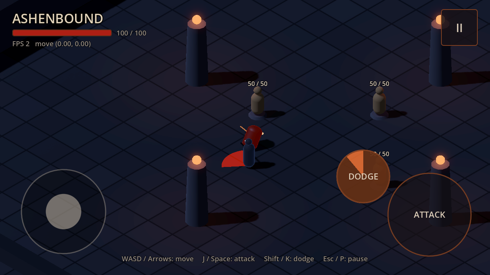
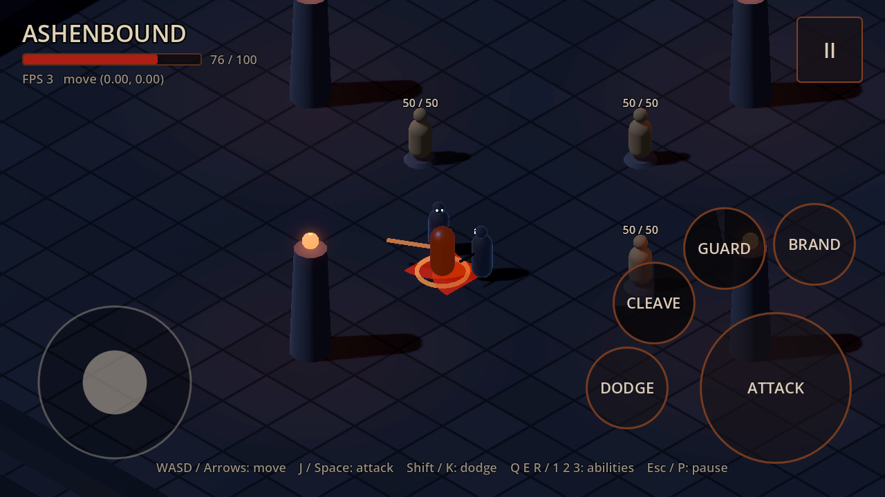
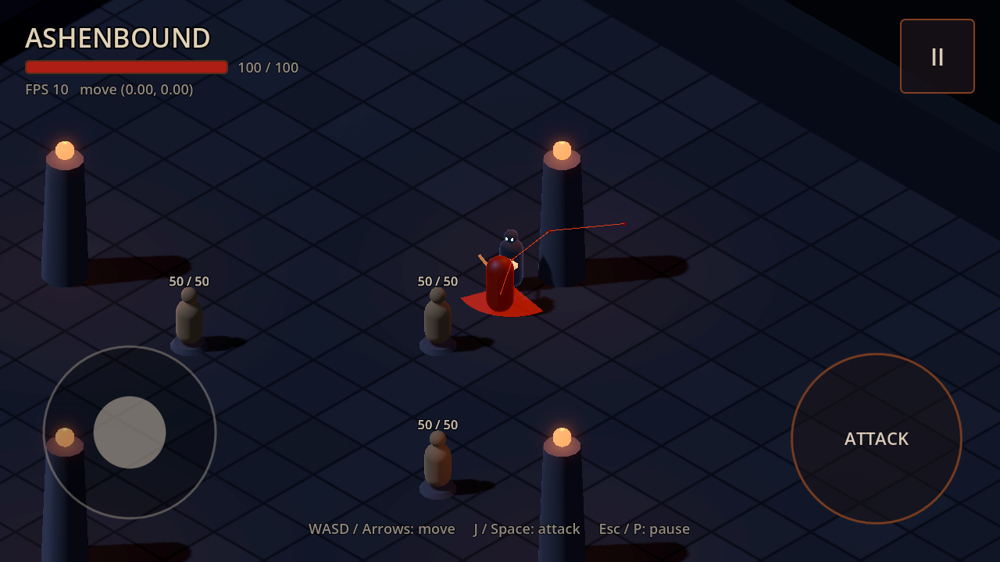

# Architecture

This document covers the current foundation (scenes, input, movement, camera,
pause and settings), combat, player health and death, and the first enemy and
how it finds its way around the arena. It will grow as systems are added.

## Scene structure

```
Main (Node3D)                         scenes/main.tscn, scripts/main.gd
├── PauseController (Node)            scripts/core/pause_controller.gd  [process: always]
├── TestArena (Node3D)                scenes/arena/test_arena.tscn
│   ├── WorldEnvironment              resources/environment/arena_environment.tres
│   ├── Moonlight (DirectionalLight3D, shadows)
│   └── Navigation (NavigationRegion3D) scripts/world/baked_navigation_region.gd, baked at load
│       ├── Floor (StaticBody3D)      44×44 m, top at y = 0, procedural flagstone shader
│       ├── Walls/{North,West}Wall    3 m tall (far side from the camera)
│       ├── Walls/{South,East}Wall    1 m tall (camera side, so they never hide the player)
│       └── Pillars/Pillar{N,S,E,W}   obstacles with an ember light on top
├── Player (CharacterBody3D)          the Warden: scenes/player/warden.tscn, scripts/player/player_controller.gd
│   ├── CollisionShape3D              capsule, radius 0.4 m, height 1.8 m
│   ├── Visual (Node3D)               turned to face movement or the attack; topples on death
│   │   └── WeaponPivot/Blade         scripts/player/weapon_swing.gd, placeholder swing
│   ├── MeleeAttack (Node)            scripts/combat/melee_attack.gd + resources/combat/player_basic_attack.tres
│   ├── Health (Node)                 100 HP
│   ├── HitFeedback (Node)            scripts/combat/hit_feedback.gd, red damage numbers
│   ├── Dodge (Node)                  scripts/combat/dodge.gd + resources/combat/player_dodge.tres
│   ├── DodgeLean (Node)              scripts/player/dodge_lean.gd, placeholder lean and squash
│   ├── CleaveAttack, Cleave          MeleeAttack (warden_cleave.tres) + CleaveAbility
│   ├── CounterAttack, Guard          MeleeAttack (warden_guard_counter.tres) + GuardAbility
│   └── Brand (Node)                  BrandAbility; puts a Burning node on its target
├── Enemies (Node3D)
│   ├── TrainingDummy{East,North,West} scenes/enemies/training_dummy.tscn, 5 m from the start
│   │   ├── Health (Node)             scripts/combat/health.gd, 50 HP
│   │   ├── HitFeedback, Visual, HealthLabel (Label3D)
│   │   └── CollisionShape3D          layer 3 "enemy"
│   └── HollowSpawner (Node3D)        scripts/enemies/enemy_spawner.gd, max 3 alive
│       ├── Spawn{NorthWest,NorthEast,SouthWest,SouthEast} (Marker3D)
│       └── Hollow (CharacterBody3D)  scenes/enemies/hollow.tscn, spawned at runtime
│           ├── Health (30 HP), HitFeedback, MeleeAttack (targets layer 2)
│           ├── NavigationAgent (NavigationAgent3D) plans the chase
│           └── Visual/{WeaponPivot, Telegraph}
├── CameraRig (Node3D)                scenes/camera/isometric_camera_rig.tscn
│   └── Camera3D                      orthographic, size 16 m
├── HUD (CanvasLayer)                 ui/hud/hud.tscn
│   └── Root
│       ├── TopBar: Title, HealthBar + HealthText, DebugLabel (debug builds only), PauseButton
│       ├── TouchJoystick             ui/hud/touch_joystick.gd, lower-left 560×420 px zone
│       ├── AttackButton              ui/hud/touch_action_button.gd, lower-right, holds `attack`
│       ├── DodgeButton               ui/hud/touch_action_button.gd, beside ATTACK, `dodge` + cooldown sweep
│       ├── Cleave/Guard/BrandButton  same script, in an arc around ATTACK, `ability_1` to `ability_3`
│       └── ControlsHint              keyboard hint, hidden on mobile
├── DeathScreen (CanvasLayer)         ui/death_screen/death_screen.tscn, "Rise again"
└── PauseMenu (CanvasLayer)           ui/pause_menu/pause_menu.tscn  [process: when paused]
```

`Settings` (`scripts/core/settings_service.gd`) is the only autoload.
`Main/PerfLog` (`scripts/core/perf_log.gd`) prints a `PERF` line of frame
statistics every 5 s in debug builds on a real display. It is used for device
testing ([DEVICE_TESTING.md](DEVICE_TESTING.md)) and removes itself in release
builds and headless test runs.

### Who talks to whom

- The UI only *emits requests*. `Hud.pause_requested` and
  `PauseMenu.resume_requested` are connected in `main.gd` to
  `PauseController.set_paused()`. The UI never pauses the tree itself.
- `PauseController.paused_changed` opens and closes the pause menu.
- `main.gd` shows the player's `Health` in the HUD (`Hud.track_health()`),
  opens the `DeathScreen` when the player dies, and reloads the scene when the
  death screen asks for a restart.
- Enemies find the player through the `PlayerController.GROUP` ("player")
  group rather than a stored reference.
- Gameplay never references the HUD. The joystick and the player communicate
  only through InputMap actions (see below).
- `PlayerController.camera` and `IsometricCameraRig.target` are node references
  wired in `main.tscn`. `PlayerController.attack`, `PlayerController.abilities`
  and `WeaponSwing.attacks` are wired in `warden.tscn`.
- On mobile, the HUD root is inset by the display safe area
  (`Hud.safe_area_insets()`), so controls stay clear of camera cutouts.

## Input mappings

Gameplay goes through these InputMap actions, defined in `project.godot`:

| Action | Keyboard (physical keys) | Touch |
|---|---|---|
| `move_left` | A, Left arrow | joystick left (analog strength) |
| `move_right` | D, Right arrow | joystick right (analog strength) |
| `move_forward` | W, Up arrow | joystick up (analog strength) |
| `move_back` | S, Down arrow | joystick down (analog strength) |
| `attack` | J, Space | **ATTACK** button (held) |
| `dodge` | Left Shift, K | **DODGE** button (tap) |
| `ability_1` | Q, 1 | **CLEAVE** button (tap) |
| `ability_2` | E, 2 | **GUARD** button (tap) |
| `ability_3` | R, 3 | **BRAND** button (tap) |
| `toggle_pause` | Escape, P | — (HUD **II** button; Android Back) |

`GameplayActions.ALL` lists the gameplay actions (movement, attack, dodge and
the three abilities).
They are the ones released when the game pauses.

Keys are bound by **physical** position, so WASD stays in the same place on
AZERTY and other layouts.

Mouse-to-touch emulation (`input_devices/pointing/emulate_touch_from_mouse`) is
on, so the touch joystick can be tested on desktop with the mouse.

### Input flow

```
Keyboard ──► InputMap actions ◄── TouchJoystick (Input.action_press with strength)
                    │
          MovementInput.get_vector()        screen-space intent, length ≤ 1
                    │
          MovementInput.to_world_direction(intent, camera basis)
                    │
          PlayerController (_physics_process) ──► move_and_slide()
```

- `MovementInput.get_vector()` reads the actions with no additional dead zone.
  Keys are digital, and the joystick applies its own dead zone. The result is
  length-limited, so diagonal keys are normalized and analog input keeps its
  magnitude.
- `to_world_direction()` projects the camera's right and forward vectors onto
  the ground plane. Up on the stick always means "away from the camera",
  whatever the pitch.
- `TouchJoystick` handles multitouch through Godot's GUI touch routing. The
  first finger inside its zone owns the stick, and other fingers are ignored. It
  **releases only the actions it pressed itself**, because
  `Input.action_release()` clears an action for every device and would
  otherwise cancel a held key.

### Why not Godot's built-in `VirtualJoystick`

Godot 4.7 added a native `VirtualJoystick` control. It was evaluated and not
used, for two reasons:

1. It has no reset API. If the finger is lifted while the game is paused or
   backgrounded, the release never reaches the (paused) control, and the stick
   stays captured.
2. It releases any pressed movement action, which cancels keys held at the same
   time.

Revisit this when those are addressed upstream.

`TouchActionButton` (the **ATTACK** and **DODGE** buttons) follows the same
rules: one finger by touch index, a round hit area, it releases the action only
if it pressed it, and it resets on pause, focus loss and when hidden. Given a
`cooldown` callable (returning 1 just after use and 0 when ready), it darkens
that share of its face clockwise from the top. The HUD gives the dodge
button `Dodge.cooldown_fraction`.

## Movement

`PlayerController` (`CharacterBody3D`):

- Runs in `_physics_process`, using `delta` for everything, so speed does not
  depend on frame rate. Physics runs at 60 Hz; the test suite checks that the
  distance covered at 30, 60 and 120 Hz agrees within 2%.
- Acceleration and deceleration use `move_toward`, which is linear in time and
  reaches exactly zero when input is released, so there is no drift.
- Tuning values live in a `MovementStats` resource
  (`resources/player/player_movement.tres`). Defaults: 6 m/s top speed, 60 m/s²
  acceleration, 80 m/s² deceleration. Other characters can reuse the type with
  different data.
- Only the `Visual` child turns to face the movement direction (or the attack
  direction while attacking). The collision capsule never rotates.
- Collision layers: 1 `world` (floor, walls, pillars), 2 `player` and 3
  `enemy`. The player is on layer 2 and collides with layers 1 and 3. Enemies
  are on layer 3 and collide with all three.
- `MovementStats` also holds the helpers that apply it (`step_velocity()`,
  `turn_toward()`, `yaw_of()`), so the player and enemies move the same way.
- 3D physics uses Jolt (`physics/3d/physics_engine = "Jolt Physics"`).

## Combat

The first slice was one melee attack against training dummies. Player health,
enemies and the dodge came after it, and are described below.

- **`Health`** (Node): `max_health`, `current`, and the signals `damaged`,
  `died` and `revived`. `apply_damage()` returns the damage actually dealt. It
  deals none to a dead target, or to any target while `invulnerable` is set.
  Otherwise it deals `amount × damage_multiplier`, rounded (Bulwark Guard sets
  0.2), and first emits `hit(amount)`, even when mitigation leaves nothing.
  Mitigation lives here so damage has one source of truth.
  Attacks find it as a direct child of the body they hit
  (`Health.of(collider)`).
- **`AttackData`** (Resource): damage, reach, arc, windup, recovery, movement
  multiplier and aim-assist radius. The player's attack
  (`resources/combat/player_basic_attack.tres`) does 10 damage at 1.8 m in a
  120° arc, with a 0.12 s windup and 0.33 s recovery: one attack every 0.45 s.
- **`MeleeAttack`** (Node, child of the attacker): `try_start(facing)` runs
  windup → hit → recovery in `_physics_process`, carrying leftover time from
  one phase into the next. The hit uses a sphere shape query on `target_mask`
  (layer 3), keeps the bodies whose centers fall inside the arc, and damages
  each one once. The attacker's own body is excluded. Aim assist turns the attack
  toward the nearest living target within `aim_assist_radius`, which matters on
  touch screens where facing is imprecise. Signals: `started(direction)` and
  `struck(targets)`.
- **`PlayerController`** starts the attack while `attack` is held, so holding
  repeats it. It slows movement by the attack's multiplier, and snaps facing to
  the attack direction while the attack runs.
- **`TrainingDummy`** (StaticBody3D, layer 3): flashes white, spawns a floating
  `DamageNumber` and updates its health label when hit. When destroyed it hides,
  stops colliding and respawns with full health after `respawn_delay` (2.5 s).
- **`HitFeedback`** (Node): on damage, flashes every mesh under a visual root
  with an overlay material, and spawns a floating `DamageNumber` in a
  configurable color (ember for enemies, red for the player).
- **Feedback** (`WeaponSwing`, `DamageNumber`, `HitFeedback`) uses tweens on
  the physics clock, so it pauses with the game and works with physics
  interpolation.
- **`MeleeAttack.cancel()`** abandons an attack in progress without resolving
  its hit. Enemies call it when they die mid-windup.

### Dodge



- **`DodgeData`** (Resource): distance, duration, invulnerable time, cooldown and
  input buffer. The player's dodge (`resources/combat/player_dodge.tres`)
  dashes 4 m in 0.3 s (13.3 m/s, about twice running speed), ignores damage for
  the first 0.25 s, and can be used again 0.9 s after it starts.
- **`Dodge`** (Node, child of the body): `try_start(direction)` and
  `step(delta) -> Vector3`. The body calls `step()` once per physics tick and
  moves with the velocity it returns. On the tick that ends the dash, only the
  part of the tick still inside the dash moves the body, so the dash covers its
  distance exactly at any tick rate (a unit test checks 24 to 144 Hz with a
  duration that is not a whole number of ticks). Signals: `started(direction)`,
  `finished` (full duration) and `canceled` (cut short).
- **Invulnerability:** while the window is open, `Dodge` sets
  `Health.invulnerable`, and `apply_damage()` deals nothing. `MeleeAttack`'s
  `struck` lists only the targets that took damage, so an evaded hit counts as a
  miss.
- **`PlayerController`:**
  - A dodge press is kept for `input_buffer` (0.2 s), so pressing slightly
    before the cooldown ends still dodges as soon as it can.
  - The dash goes toward the movement input, or toward the facing when there
    is none.
  - Starting a dodge cancels the attack in progress (an attack in its windup
    never lands), and no attack starts during the dash even with the button
    held.
  - When the dash ends, horizontal speed is capped to running speed, so the
    body slides about 0.2 m rather than carrying dash speed.
  - Death cancels a dash and its invulnerability.
- **`DodgeLean`:** leans the visual 30° forward and squashes it while the dash
  runs, then straightens it. On `canceled` it straightens at once, so the death
  topple starts from rest.

Known simplifications: the dash is blocked by enemies like any movement (it
does not pass through them), and there is no visual cue yet for an evaded hit
beyond the missing damage number.

### Warden abilities

The design, numbers and acceptance checks are in
[characters/warden.md](characters/warden.md).



- **`Ability`** (Node, a child of the body): `display_name`, an InputMap
  `action` and a `cooldown`.
  - `try_activate(facing)` calls the subclass's `_activate()`. The cooldown
    starts only if `_activate()` succeeds, so a Brand with no target costs
    nothing.
  - The cooldown runs on the physics clock, so it pauses with the game.
  - Subclasses report `is_busy()`, `movement_multiplier()` and `facing()`
    while they play out, and implement `cancel()`.
- **`CleaveAbility`** wraps a second `MeleeAttack` with its own `AttackData`:
  25 damage, 2.6 m, 220°, 0.3 s windup.
- **`GuardAbility`:**
  - For 1 s it sets `Health.damage_multiplier` to 0.2 and roots the Warden.
  - On the first `hit` of each guard, it starts its counter: a 360°, 15-damage
    `MeleeAttack` with no windup.
  - The ember ring is visual only.
- **`BrandAbility`** finds the nearest living enemy within 7 m with
  `Targeting.nearest_living()` and applies `Burning` to it.
- **`Burning`** (Node3D on the target):
  - 4 damage every 0.5 s, 8 times, carrying leftover time between ticks so the
    rate holds at any tick rate.
  - Applying it again restarts the count instead of adding a second burn.
  - It stops when the target dies. Its ember mark is visual only.
- **`Targeting`:** the sphere query that finds living Health on given
  layers. `MeleeAttack` uses it too, for hits and aim assist.
- **`PlayerController`** starts an ability on its action's press when no ability
  is busy.
  - **Priority:** a dodge cancels abilities and the basic attack; an ability
    cancels the basic attack; nothing starts while an ability plays out.
  - While an ability is busy, the controller uses that ability's movement
    multiplier and facing.
  - Death cancels all abilities.
- **`WeaponSwing.attacks`:** a list of attacks, so the basic attack and Cleave
  sweep the same greatsword.
- **`Hud.track_abilities()`** labels each ability button after the ability
  bound to its action, and wires its cooldown sweep.

Known simplifications:

- Ability presses are not buffered: one made while another ability plays out
  is ignored.
- The counter hits all around the Warden rather than toward the attacker.
- Abilities have no visual windup beyond the sword swing, the guard ring and
  the ember mark.

### Attack limitations

Known simplifications: the arc check uses target *centers*, so a large enemy
whose edge overlaps the arc but whose center is outside it is missed. Attacks
can only start on a physics tick, so each attack cycle can last up to one tick
longer than its data says: at most 33 ms at 30 Hz and 17 ms at 60 Hz. The test
suite checks that the number of attacks in 2 s is the same at 30, 60 and 120 Hz.

## Player health and death

- The player has a `Health` (100 HP) and a `HitFeedback`. The HUD shows it as
  a bar and "current / max" text.
- On death, `PlayerController` stops taking input and the visual topples
  forward over 0.4 s. `main.gd` releases held gameplay input and opens the
  `DeathScreen`.
- `DeathScreen` fades in after 0.8 s, so the fall plays first. Its
  **Rise again** button stays disabled until the screen is visible, so a stray
  tap during the fall cannot restart. It emits `restart_requested`, and
  `main.gd` reloads the scene.

## Enemies

The first enemy is the **Hollow**, a slow melee chaser. It is meant to read
clearly on a phone: a long, visible windup that the player can step out of.

- **`EnemyBehavior`** (Resource): aggro radius 9 m, leash radius 15 m, attack
  range 1.4 m (center to center), corpse time 1.2 s.
- **`EnemyController`** (CharacterBody3D) runs a small state machine in
  `_physics_process`:
  - **IDLE:** waits until a living player is within aggro range.
  - **APPROACH:** walks to the player along a navigation path (see below) with
    `MovementStats` (3.4 m/s, slower than the player's 6 m/s). It gives up
    beyond the leash range or when the player dies.
  - **TELEGRAPH:** the windup of its `MeleeAttack` (0.5 s). It stands still
    and faces the target while the ground sector shows where the hit will
    land.
  - **ATTACK:** the single physics tick on which the hit resolves: 12 damage,
    1.6 m reach, 100° arc.
  - **RECOVERY:** the attack's 0.7 s recovery, standing still. Then the
    Hollow approaches again, or goes idle if the player is gone.
  - These follow the charter's enemy states. Each change emits
    `state_changed(previous, current)`, which tests use to check the sequence
    and timing, and which animation can use later.
  - **DEAD:** cancels any pending hit, stops colliding, sinks into the floor
    and frees itself, emitting `despawned`.
- **`AttackTelegraph`** (MeshInstance3D under the enemy's visual): a red
  ground sector built from the attack's reach and arc. It shows only during the
  windup and grows more opaque as the hit approaches.
- **`EnemySpawner`** (Node3D): keeps `max_alive` enemies alive, spawning at
  its `Marker3D` children. It picks the free point (no living enemy within
  1.5 m) farthest from the player, and replaces each enemy `respawn_delay`
  (4 s) after its corpse is removed. Give it at least `max_alive` points:
  enemies spawned on top of each other get pushed apart violently by the
  physics engine, which is exactly the bug the regression test guards against.
- Balance: three player hits kill a Hollow. A Hollow standing next to the
  player deals 12 about every 1.2 s.

### Navigation



- **Navigation mesh.** The arena's floor, walls and pillars are children of a
  `BakedNavigationRegion` (a `NavigationRegion3D`), which bakes its navigation
  mesh when the level loads. The bake settings live in
  `resources/navigation/ground_navigation_mesh.tres`: static colliders on the
  *world* physics layer only, agent radius 0.5 m (a Hollow's capsule is
  0.4 m), agent height 2 m, and islands smaller than 1 m² dropped so the tops
  of pillars are not walkable. The region bakes into a private copy of that
  shared resource; baking into the shared one would hand its polygons to every
  other region using it. The bake takes about 10 ms on a desktop CPU, on the
  main thread during scene load. Larger levels should be baked in the editor
  and saved instead.
- **Path following.** Each Hollow has a `NavigationAgent3D`. While chasing,
  `EnemyController` sets the agent's target to the player's position whenever
  the player has moved more than `REPATH_DISTANCE` (0.5 m) from the end of the
  current path, then walks toward `get_next_path_position()` every physics
  frame. The walking itself is unchanged: the same acceleration, turning and
  `move_and_slide`, so speed stays independent of the tick rate.
- **Fallback.** With no path to follow, the Hollow steers straight at the
  player. That covers a level without a navigation mesh, the frames before the
  map first synchronizes, and the last stretch of every chase (the agent
  reports navigation finished within 1 m of the player).
- **Path height.** Baking lifts the mesh 0.5 m above the floor (two cells of
  0.25 m). The agent's `path_height_offset` of 0.5 m brings path points back to
  the Hollow's feet. Without it, the agent's 0.5 m waypoint-distance check
  could never pass, because the vertical gap alone is 0.5 m. A test checks that
  the two still match.
- **Synchronous map updates.** `navigation/world/map_use_async_iterations` and
  `region_use_async_iterations` are off. The arena's map is tiny and changes
  only at load, so updating it on the main thread costs next to nothing, and
  paths become available on a predictable physics frame (the tests rely on
  this).
- **Debugging.** Run from the editor with **Debug > Visible Navigation** to see
  the mesh. Set `debug_enabled` on a Hollow's `NavigationAgent` to draw its
  path.

Known simplifications:

- Training dummies are not part of the navigation mesh, which only bakes the
  arena's own geometry. Hollows slide around a dummy rather than plan around
  it.
- No avoidance between enemies: Hollows can bunch up behind each other.
  `NavigationAgent3D` avoidance (RVO) is available when crowds grow.
- Aggro and leash ranges are straight-line distances, not path lengths.
- Player hits do not interrupt an enemy's windup (no stagger).
- Idle enemies stand still rather than wander.

## Camera

`IsometricCameraRig`:

- Orthographic `Camera3D`, true isometric angle: yaw 45°, pitch −35.264°
  (atan(1/√2)).
- The rig's rotation is set once in `_ready()` and never changes. The rig only
  translates.
- It follows the target with exponential smoothing (`1 - exp(-k·delta)`), which
  behaves the same at any frame rate.
- Physics interpolation is enabled project-wide, so motion is smooth on
  90/120 Hz displays. The rig reads the target's *interpolated* transform in
  `_process` and has interpolation turned off for itself.

## Pause and focus

`PauseController` owns `get_tree().paused`:

- Pause sources: `toggle_pause` (Esc or P), the HUD **II** button, Android Back
  (`quit_on_go_back` is disabled), losing focus, and the app moving to the
  background. Regaining focus does **not** resume; the player resumes
  explicitly.
- Every pause transition calls `GameplayActions.release_all()`, which covers
  movement and attack. Input that ends while the game is paused (a lifted
  finger, a released key) never reaches gameplay, so anything held is dropped
  rather than left stuck.
- `TouchJoystick` and `TouchActionButton` reset themselves on
  `NOTIFICATION_PAUSED`, on application focus loss and when hidden.
- An attack or dodge in progress freezes with the game and finishes after
  resuming. A dodge that is paused keeps its invulnerability until it ends.

## Settings

- `GameSettings` (Resource) holds player options: joystick dead zone and
  sensitivity (controls), and render scale and FPS cap (graphics).
- The `Settings` autoload loads `user://settings.cfg` at startup (a missing file
  means defaults), applies graphics options to the engine, and emits `changed`.
  Values read from disk are type-checked and clamped.
- Systems pull what they need on `changed`. For example, the HUD forwards the
  joystick options to `TouchJoystick`. There is no settings screen yet.
  `Settings.save_to()` is ready for one.

## Rendering

- Mobile renderer (Vulkan), with automatic fallback to OpenGL ES 3 on devices
  without Vulkan.
- ETC2/ASTC texture compression is enabled, as required for Android export.
- Base resolution is 1280×720 with `canvas_items` stretch and `expand` aspect.
  The UI anchors to screen edges, so wider phones (20:9) show more of the arena
  instead of letterboxing.

## Tests

`game/tests/` contains a small headless runner (`run_tests.gd`) and suites
named `test_*.gd`. Each test method runs on a fresh suite instance in the scene
tree. Integration tests instantiate the real `main.tscn` through
`instantiate_main()`, which switches enemy spawners off unless asked
(`instantiate_main(true)`), so movement and UI tests run in a quiet arena.
`wait_until(condition, max_frames)` waits for a state without hard-coding
frame counts. `add_level(size, obstacles)` builds a floor with box obstacles
under a navigation region baked like the arena's, and `wait_for_navigation()`
waits until the map can plan paths over it. A test fails on a
failed `check` or on any engine or script error logged during it, captured with
a custom `Logger`. Warnings are printed under the test that logged them, and
counted in the summary, but do not fail it. Run them with `tools/test.sh`.

## Conventions

- Typed GDScript throughout. `class_name` is used only for types other code
  refers to.
- One responsibility per script; UI scripts live next to their scenes in `ui/`.
- Add folders when a system's implementation begins. Do not create empty module
  folders ahead of time.
