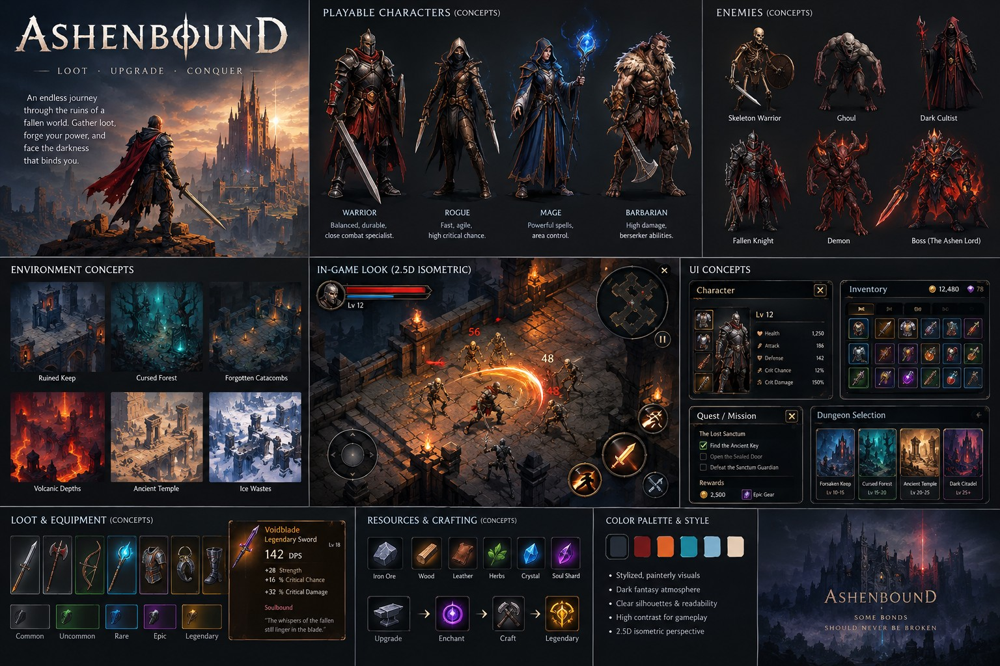

# Art direction

The project owner supplied this generated concept sheet as the reference for
Ashenbound's look and scope. It sets mood, palette and screen layout. It is not
a source of shipping assets, and the numbers in it (stats, prices, level
ranges) are illustrative.

Full resolution (1536×1024): [`art/concept-sheet.jpg`](art/concept-sheet.jpg).

## Style pillars

From the sheet's "Color palette & style" panel:

- Stylized, painterly visuals
- Dark fantasy atmosphere
- Clear silhouettes and readability
- High contrast for gameplay
- 2.5D isometric perspective

Tagline: *Loot · Upgrade · Conquer*. Closing line: *Some bonds should never be
broken.*

## Palette

Sampled from the centers of the six swatches on the sheet. Roles are a proposal
based on where the colors appear in the concept art.

| Swatch | Hex | Proposed role |
|---|---|---|
| Charcoal | `#262D37` | Panel and HUD backgrounds, deep shadow |
| Blood red | `#6F191A` | Health, danger, enemy accents |
| Ember orange | `#DB6028` | Highlights, fire, selected and pressed states, the player's attacks |
| Teal | `#1C859C` | Magic, mana, enchanting |
| Pale blue | `#7DAECA` | Cold light, secondary text accents, undead eyes |
| Bone | `#E2CBB4` | Body text and titles |

## Loot rarity

Sampled from the brightest frame pixels of the five rarity tiles in the "Loot &
equipment" panel. Frames on a phone may need to be brightened for contrast, but
the hue order should stay.

| Tier | Frame color |
|---|---|
| Common | `#838488` (gray) |
| Uncommon | `#529B4D` (green) |
| Rare | `#259FD2` (blue) |
| Epic | `#7B4289` (purple) |
| Legendary | `#D9A44C` (amber) |

## What the build already matches

- Fixed 2.5D isometric camera.
- The in-game panel's screen layout:
  - health top left;
  - movement stick bottom left;
  - attack button bottom right;
  - pause top right;
  - damage numbers over enemies.
- Dark stone floor lit by ember-topped pillars.
- Body text in a bone color close to the palette (`#DBCCB8` vs `#E2CBB4`).
- Ember-orange highlights on the touch controls and buttons.

Where it differs:

- **Backgrounds are warm near-black, not cool charcoal.** The UI theme's
  panels and buttons use `#0F0D12` to `#171217`; the sheet uses `#262D37`.
- **The health bar is a brighter red than the sheet's blood red.** The theme
  uses `#AD1F14`. The in-game panel itself shows a bright red bar, so this may
  be right for readability.

## What the sheet adds

The order of work follows the milestones in the charter
([CLAUDE.md](../CLAUDE.md)), not this sheet. The live plan is in
[CURRENT_STATUS.md](CURRENT_STATUS.md).

- **Done:** the skill button cluster around **ATTACK**. Its first skill is a
  dodge.
- **Next:** the Warden's starter abilities, which fill the rest of the cluster.
- **Parked until Milestone 4:** loot drops with rarity. The charter's ladder
  adds a sixth tier, **Mythic**, above Legendary. The sheet shows no color for
  it; one will be chosen when loot resumes.

Further elements of the sheet:

- **HUD:**
  - a portrait and level next to the health bar;
  - a mana bar (teal);
  - a minimap in the top-right corner.
- **Enemies:** Skeleton Warrior, Ghoul, Dark Cultist, Fallen Knight, Demon, and
  a boss, the Ashen Lord. The current Skeleton Warrior is a placeholder.
- **Playable classes:** the sheet shows a Warrior, Rogue, Mage and Barbarian.
  The charter's roster supersedes them: Warden, Reaver, Hexbinder,
  Dreadhunter, Reliquary and Gravecaller, starting with the Warden.

- **Screens:** character (stats: health, attack, defense, critical chance,
  critical damage), inventory (gold and a premium currency), quest and mission
  tracker with rewards, and dungeon selection with level ranges.
- **Crafting:**
  - resources: iron ore, wood, leather, herbs, crystal, soul shard;
  - steps: upgrade, enchant, craft, legendary.
- **Environments:** Ruined Keep, Cursed Forest, Forgotten Catacombs, Volcanic
  Depths, Ancient Temple, Ice Wastes. The test arena is closest to the Ruined
  Keep and Forgotten Catacombs.

Accounts and any backend stay out of scope until asked for.

## 2026-10-23: two directions under test

The owner asked for a less basic, less cartoony look and named two
directions. Both are playable behind a title-screen switch, and the owner
will choose: see [ART_STYLE_TEST.md](ART_STYLE_TEST.md). Until then, this
document's direction stands.
