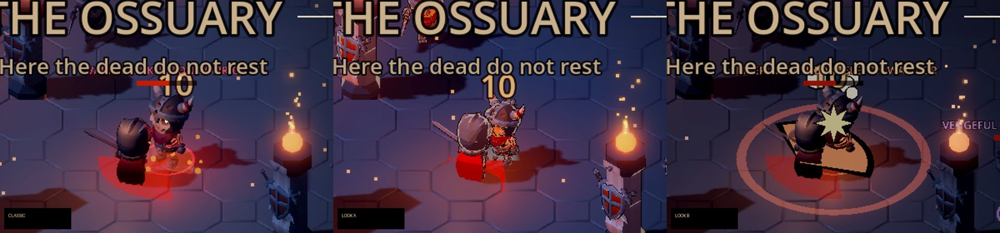
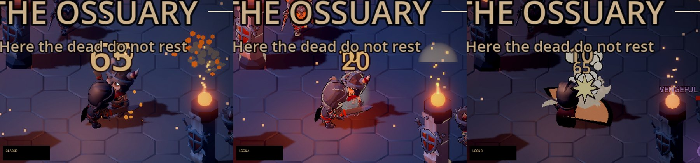
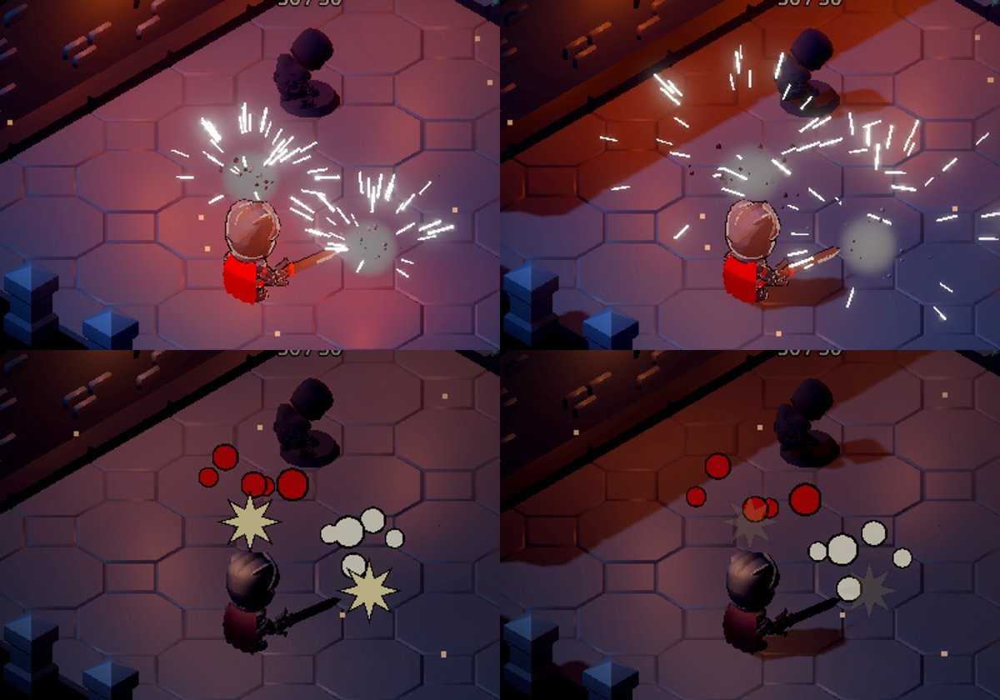

# Art style test: Look A against Look B

On 2026-10-23 the owner found the graphics "too basic" and "too cartoony", and
named two directions:

- **A:** cartoony characters, realistic attack animations and
  photorealistic effects;
- **B:** hyper-realistic characters and atmosphere, with Castle
  Crashers-style cartoony effects.

The owner chose to **see both before choosing**. This test puts both in the
game behind one switch, so they can be played side by side in any class and
either dungeon.

**Status:** a test, not a decision. **Classic** (the look so far) stays the
default until the owner picks a direction. The charter's art direction
(v2.0 §9) is unchanged until then.

## How to compare

On the title screen, the row under the class cards has **Classic**,
**Look A** and **Look B**. The choice is saved, and it applies from the next
run: press **Enter the crypt** after choosing.

## What each look changes

| | Look A ("bold heroes, real effects") | Look B ("grim world, cartoon effects") |
|---|---|---|
| **Characters** (heroes, enemies, summons) | Cel-shaded in three hard light bands, more saturated colour, a bright rim on the silhouette, a thick ink outline. | Worn, real materials: muted colour, fine relief and grime, grey steel turned metallic and glossy. |
| **World** | As built. | Stone made heavy and real: large-scale relief, damp grimy hollows that catch the torchlight, muted colour. Walls keep the see-through hole around the hero. |
| **Grade** | Warmer and more saturated, a little more glow. | Desaturated, more contrast, thicker fog, less bloom. |
| **Hits** | White-hot spark streaks that fall and cool, a glare at the point of contact, a flash of light, smoke, bone chips (undead) or blood droplets (heroes). | A comic star that pops at the impact, and fat ink-outlined blobs (bone or blood) that bounce and squash. |
| **Kills** | A dust cloud and debris, and a blood pool spreading on the floor for the living. | A ring of round, outlined puffs and a big star. |
| **Swings** | A thin, white-hot motion-blur streak. | A thick, solid, ink-outlined smear. |
| **Being hit** | A jolt backward that recovers (a flinch). | A big rubbery squash. |

**Attack weight**, in both A and B:
- **Hit-stop:** the moment a blow lands, the game runs at 5% speed for about
  0.06 s (0.09 s for a critical hit, 0.14 s for killing a champion, elite or
  boss), so the blow is felt.
- **Lunge:** the body draws back through the windup, drives forward as the
  blow lands (0.32 m in A, 0.5 m in B), and settles. Only the model moves:
  reach, collision and the hero's position are unchanged.

Every one of these is presentation. Damage, timing, reach and rewards are
the same in all three looks. `test_art_style.gd` checks this: the same blow
deals the same 10 in each look.

## What this test cannot show yet

- **New animation clips.** The characters still use the KayKit clips. Look
  A's "realistic attack animations" are approximated with procedural weight
  (hit-stop, lunge, flinch). Real motion-captured attacks need animation
  assets, such as licensed mocap or an animator.
- **Truly realistic characters for Look B.** Look B gives the existing
  cartoon-proportioned models realistic materials. It cannot change their
  shapes or proportions. A real Look B needs realistic rigged character
  models, which are not available for free from this environment: the free
  asset sites it can reach are blocked, apart from GitHub. They would have
  to be bought, licensed or provided.
- **Photorealistic effects** are built from particles and shaders. Real
  flipbook textures (fire, smoke, blood) would raise them further, and need
  sourced assets.

The cost of the two directions differs:
- **Look A** can be finished here with what exists: stronger cel shading,
  more effects, better attack timing.
- **Look B's** look will only land fully once realistic character models
  arrive.

## Code

- `ArtStyle` (`scripts/presentation/art_style.gd`): the look, restyled
  materials, world dressing and the grade.
- Shaders:
  - `resources/shaders/toon_character.gdshader` (A);
  - `resources/shaders/grim_surface.gdshader` (B, with the optional
    cutout).
- Effects: `RealFx` (A) and `ToonFx` (B), called from `HitFeedback` and
  `AttackSwoosh`.
- Attack weight:
  - `HitStop`;
  - `CharacterAnimator._lunge()`;
  - `HitFeedback._punch(look)`.
- The setting: `GameSettings.art_style`. The title screen's look buttons call
  `TitleScreen.choose_look()`.

## Checks

- `tests/test_art_style.gd`:
  - the setting is saved and clamped;
  - each look's materials, cached;
  - look B's walls keep the cutout;
  - a full crypt run in each look, with the same damage;
  - hit-stop only in A and B, always ending, including when the run is left;
  - the lunge moves the model, not the body;
  - the title's look buttons.
- Rendered under Xvfb (Mobile renderer): the same blow and kill in all three
  looks, and both effect sets close up (the images above).
- Web build (Compatibility renderer, Chromium): both looks played into the
  crypt with no shader errors in the browser console.

## Not tested

- On a phone: the frame rate of Look B's surface shader and Look A's
  heavier effects, and how either reads on a small screen.
